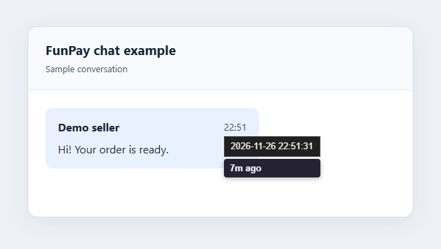
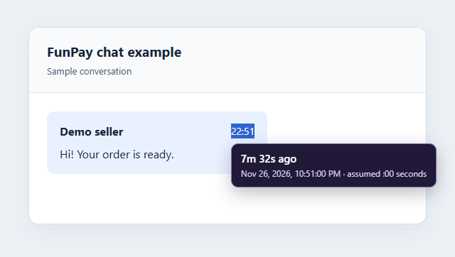
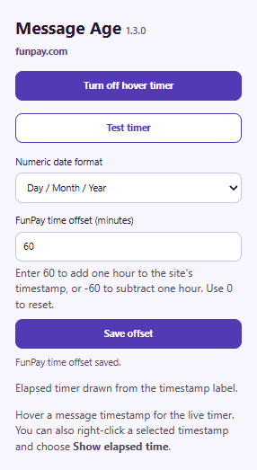

# Message Age for FunPay

**English** · [Русский](README.ru.md)

Message Age 1.3.0 shows how much time has passed since a FunPay message was sent. It runs only on HTTPS pages at funpay.com and www.funpay.com, calculates elapsed time locally, and saves preferences in browser storage.

## Use the timer

The screenshots show the extension running in Brave on a sample conversation.

### Live hover timer

Hover over a FunPay message timestamp. The timer updates every second. Move away or press Escape to dismiss it.

### Right-click timer

Select a timestamp, right-click, and choose **Show elapsed time**.

### FunPay time offset

Open the extension popup to toggle the hover timer, select a numeric date format, or set the **FunPay time offset**. Enter 60 to add an hour, -60 to subtract an hour, or 0 to reset, then click **Save offset**. An explicit time zone in a timestamp takes precedence.

## Install locally

Clone or download this repository. If you downloaded a ZIP from GitHub, extract it first.

### Chrome, Brave, and Edge

1. Open the extensions page in your browser using `chrome://extensions`, `brave://extensions`, or `edge://extensions`.
2. Turn on **Developer mode** and choose **Load unpacked**.
3. Select the [chromium](chromium/) folder, which contains the Chromium `manifest.json`.
4. Refresh any open FunPay tabs.

When updating, keep the same folder to retain your settings. Click **Reload** on the extension card and refresh FunPay.

### Firefox

1. Open `about:debugging#/runtime/this-firefox` in Firefox.
2. Click **Load Temporary Add-on…** and select [firefox/manifest.json](firefox/manifest.json).
3. Refresh any open FunPay tabs.

Firefox removes temporary add-ons on restart. A permanent installation on standard Firefox requires a Mozilla-signed build. This manifest requires Firefox 140 or later.

## Source layout

[chromium/](chromium/) and [firefox/](firefox/) each contain a complete, loadable build with its own manifest. Chromium uses a background service worker and Firefox uses a background script. The JavaScript, popup HTML, and icons are identical across both builds.
