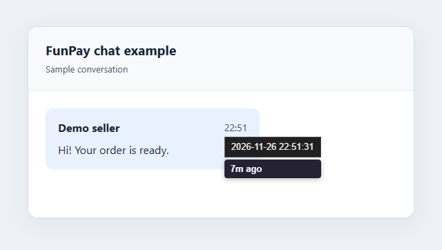
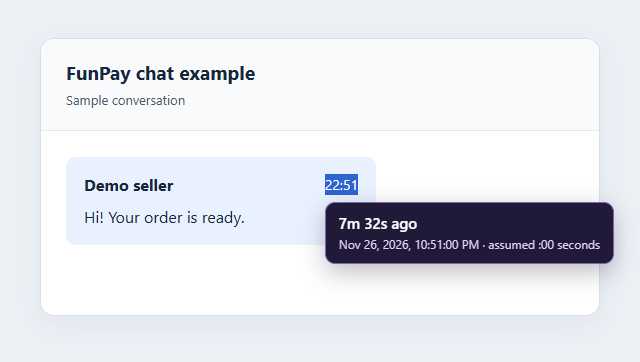
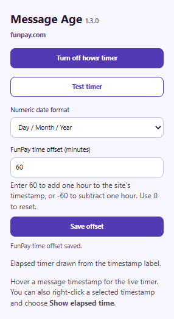

# Message Age для FunPay

[English](README.md) · **Русский**

Message Age 1.3.0 показывает, сколько времени прошло с момента отправки сообщения на FunPay. Расширение работает только на HTTPS-страницах funpay.com и www.funpay.com, вычисляет время локально и сохраняет настройки в браузере.

## Как пользоваться таймером

На скриншотах показан пример переписки в Brave. Интерфейс расширения на скриншотах на английском языке.

### Таймер при наведении

Наведите указатель на время отправки сообщения. Таймер обновляется каждую секунду. Чтобы закрыть его, отведите указатель или нажмите Escape.

### Таймер через контекстное меню

Выделите время отправки, нажмите правой кнопкой мыши и выберите **Show elapsed time** («Показать прошедшее время»).

### Поправка времени FunPay

Откройте меню расширения, чтобы включить или выключить таймер при наведении, выбрать формат даты или задать поправку времени FunPay (**FunPay time offset**). Введите 60, чтобы прибавить час ко времени отправки, −60, чтобы вычесть час, или 0, чтобы сбросить поправку. Нажмите **Save offset** («Сохранить поправку»). Если во времени отправки явно указан часовой пояс, он имеет приоритет.

## Локальная установка

Клонируйте или скачайте этот репозиторий. Если вы скачали ZIP-архив с GitHub, распакуйте его перед установкой.

### Chrome, Brave и Edge

1. Откройте страницу расширений своего браузера по адресу `chrome://extensions`, `brave://extensions` или `edge://extensions`.
2. Включите **Режим разработчика** и нажмите **Загрузить распакованное расширение** (**Load unpacked**).
3. Выберите папку [chromium](chromium/), в которой находится файл `manifest.json`.
4. Обновите открытые вкладки FunPay.

При обновлении используйте ту же папку, чтобы сохранить настройки. Нажмите **Перезагрузить** (**Reload**) на карточке расширения и обновите страницу FunPay.

### Firefox

1. Откройте `about:debugging#/runtime/this-firefox` в Firefox.
2. Нажмите **Загрузить временное дополнение…** (**Load Temporary Add-on…**) и выберите файл [firefox/manifest.json](firefox/manifest.json).
3. Обновите открытые вкладки FunPay.

Firefox удаляет временные дополнения при перезапуске. Для постоянной установки в стандартной версии Firefox нужна сборка, подписанная Mozilla. Для этой сборки требуется Firefox 140 или новее.

## Структура исходного кода

Папки [chromium/](chromium/) и [firefox/](firefox/) содержат готовые к установке сборки со своим манифестом. В Chromium используется фоновый сервис-воркер, а в Firefox — фоновый скрипт. JavaScript, HTML меню расширения и значки одинаковы в обеих сборках.
