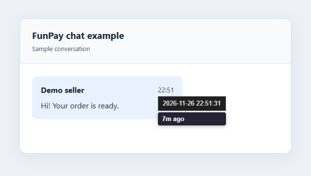
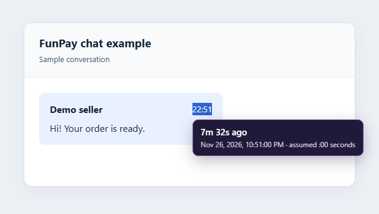
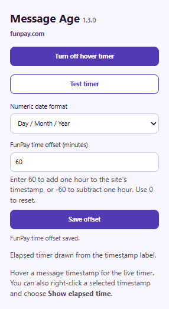

# Message Age screenshot guide

These screenshots show Message Age 1.3.0 running in Brave on a sample conversation. See the [README](../README.md#install-locally) for local installation steps.

## Hover over a timestamp

Move your pointer over the timestamp beside the sender’s name. The extension shows the original timestamp and updates the elapsed time every second. Move away or press Escape to dismiss it.

## Show elapsed time from the right-click menu

Select a timestamp, right-click the selection, and choose **Show elapsed time**. The screenshot shows the resulting timer next to the selected text. If the selection has no seconds, the timer assumes `:00`.

## Adjust the FunPay time offset

Open **Message Age** from the browser toolbar. Enter the number of minutes to add to the site’s displayed time and click **Save offset**. Use `60` to add an hour, `-60` to subtract an hour, or `0` to reset. If the timestamp already specifies a time zone, that zone takes precedence.

